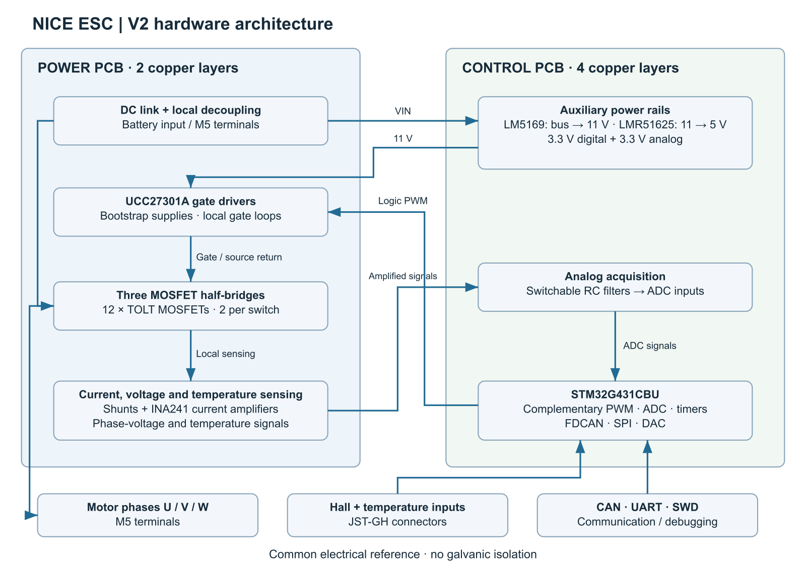
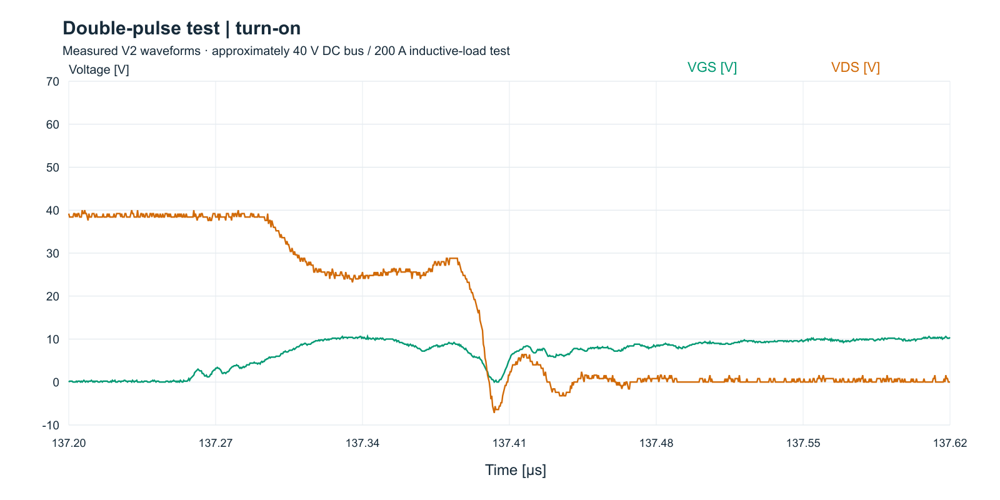
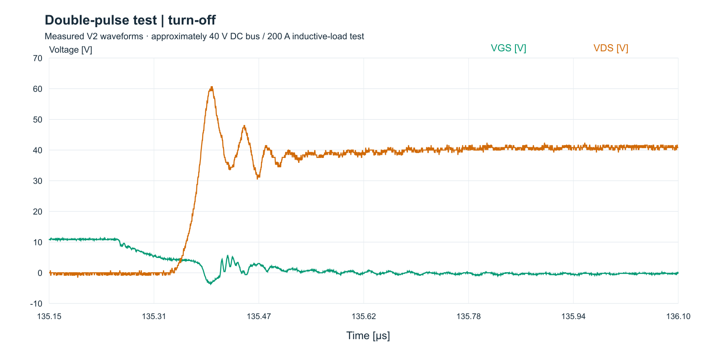

# NICE ESC

**A two-board, high-current three-phase inverter for BLDC/PMSM motor control and bidirectional power conversion.**

## Capabilities and key components

- **4S–16S Li-ion design range**, covering 60 V-class applications; a fully charged 16S pack reaches **67.2 V**. An **84 V / 20S variant** is a development option with higher-voltage MOSFETs and a full bus-voltage margin review.
- **200 A peak phase-current design target**, with double-pulse switching tests extended to approximately **328 A** at a 40 V bus. Higher pulse-current capability is being explored; this is not a continuous-current or thermal rating.
- Hardware for **six-step control, FOC, Hall-based position feedback and active rectification**, depending on the firmware.
- **5–40 kHz PWM design range**, phase-current and voltage acquisition, temperature inputs, CAN, UART and SWD.

| Function | Hardware |
|---|---|
| Controller | STM32G431CBU, complementary PWM and synchronized ADC acquisition |
| Power switches | 12 × IAUS300N10S5N015T, with two MOSFETs in parallel per switch |
| Gate drive | UCC27301A half-bridge drivers, bootstrap circuits and approximately 11 V gate supply |
| Current sensing | Shunts and INA241 amplifiers located on the power PCB |
| Signal conditioning | Switchable RC filters for current and voltage measurements |
| Auxiliary rails | LM5169 bus-to-11 V buck, LMR51625 11-to-5 V buck, separate 3.3 V digital and analog rails |
| Interconnects | M5 battery/phase terminals and locking JST-GH signal connectors |
| PCB stack-up | Four copper layers on the control board; two on the power board |

The published switching measurements were made at approximately **40 V**, not at the maximum intended battery voltage. Operation at the upper end of the voltage/current range depends on switching overshoot, cooling, capacitor ratings and the complete populated BOM.

## V2 architecture

The two boards share a common electrical reference. Gate drivers, gate components and current amplifiers are kept close to the power devices, so the board-to-board connections carry logic-level PWM and amplified measurements rather than long gate loops or raw shunt signals.

## Assembly and mechanical integration

The control PCB sits above the power PCB. Top-side-cooled TOLT MOSFETs are mounted on the underside of the power board, providing access to their cooling surfaces. STEP models of both boards and the enclosure are included.

## TOLT MOSFET options

The baseline device is the **IAUS300N10S5N015T**, an OptiMOS 5 100 V TOLT MOSFET. Higher-voltage OptiMOS 6 devices offer a useful trade-off between voltage headroom and on-resistance:

| Device | Technology | VDS rating | Maximum RDS(on), VGS = 10 V | Role |
|---|---|---:|---:|---|
| [IAUS300N10S5N015T](https://www.infineon.com/part/IAUS300N10S5N015T) | OptiMOS 5 | 100 V | 1.5 mΩ | Baseline build |
| [IPTC017N12NM6](https://www.infineon.com/part/IPTC017N12NM6) | OptiMOS 6 | 120 V | 1.7 mΩ | Higher-voltage candidate |
| [IPTC020N13NM6](https://www.infineon.com/part/IPTC020N13NM6) | OptiMOS 6 | 135 V | 2.0 mΩ | Additional voltage headroom |

Values are the manufacturers' room-temperature specifications per MOSFET, not the resistance of the whole inverter. The 120 V option adds only 0.2 mΩ relative to the baseline. These TOLT candidates provide a path toward an 84 V bus variant, subject to checking the exact footprint/pinout, gate charge, switching behavior and voltage margins of the drivers, capacitors, auxiliary supplies and sensing circuits. Changing the MOSFET voltage rating alone does not qualify the complete board for 84 V.

## Double-pulse testing

A double-pulse test first builds current in an air-core inductor, then captures turn-off and the subsequent turn-on under load. The measurements below were taken at approximately **40 V bus voltage and 200 A inductor current**, using an approximately **8 µH** air-core load and an **11 V** gate supply.

At 200 A, the recorded drain-source peaks remain around **60 V on a 40 V bus**, leaving substantial headroom below the baseline MOSFET's 100 V rating. The extracted VDS transition times are approximately **101 ns at turn-on** and **33 ns at turn-off**. These are voltage-edge durations, not complete gate-command delays.

The test campaign was also pushed to approximately **328 A**, the current acquisition range limit, without a notable increase in the observed VDS peaks. The plots shown here are the **200 A acquisition**. These short-pulse results are encouraging for the commutation layout; sustained phase-current capability still depends on thermal validation.

The measured current is the inductor current, so the captures are used to assess overshoot and ringing rather than to claim precise Eon/Eoff measurements. [Raw acquisitions and the viewer](DOC_AND_SIMULATION/DPT_200A/) and the [LTspice test circuit](DOC_AND_SIMULATION/LTSPICE_SIMULATION_DPT/) are included.

## DC-link decoupling

The DC link combines bulk energy storage with local, low-inductance ceramic decoupling:

| Capacitor bank | Selection | Purpose |
|---|---|---|
| Bulk electrolytics | **4 × 820 µF / 100 V = 3280 µF** | Reduce the lower-frequency DC-link ripple and supply transient energy |
| Local MLCCs | **18 × 4.7 µF / 100 V, 2220 = 84.6 µF nominal** | Supply fast switching-current loops close to the half-bridges and limit parasitic-inductance overshoot |

For a first-order capacitive-ripple estimate, `ΔVpp ≈ Iphase,peak / (4 × fPWM × Cbulk)`. At **200 A and 20 kHz**, a 2 V ripple target gives **1250 µF minimum**; the selected 3280 µF gives approximately **0.76 V calculated capacitive ripple**. Actual ripple also depends on ESR/ESL, RMS current and temperature. The MLCC total is nominal: effective capacitance falls with DC bias. Placement and short commutation loops matter alongside the capacitance value.

## Repository

| Directory | Contents |
|---|---|
| [Control PCB](HARDWARE/V2/CONTROL_BOARD_V2/) | KiCad project, schematics, layout and local libraries |
| [Power PCB](HARDWARE/V2/POWER_BOARD_V2/) | KiCad project, schematics, layout and local libraries |
| [Board STEP models](HARDWARE/V2/3D/) | Mechanical board assemblies |
| [Enclosure](HARDWARE/INVERTER_CASE_3D/) | Top and bottom STEP models |
| [Documentation and simulation](DOC_AND_SIMULATION/) | DPT data, LTspice files and project media |

Open either `.kicad_pro` file with **KiCad 10**. Project libraries use the `_local` suffix and `${KIPRJMOD}` paths; the required symbols, footprints and 3D models are included. This repository currently focuses on the hardware.
