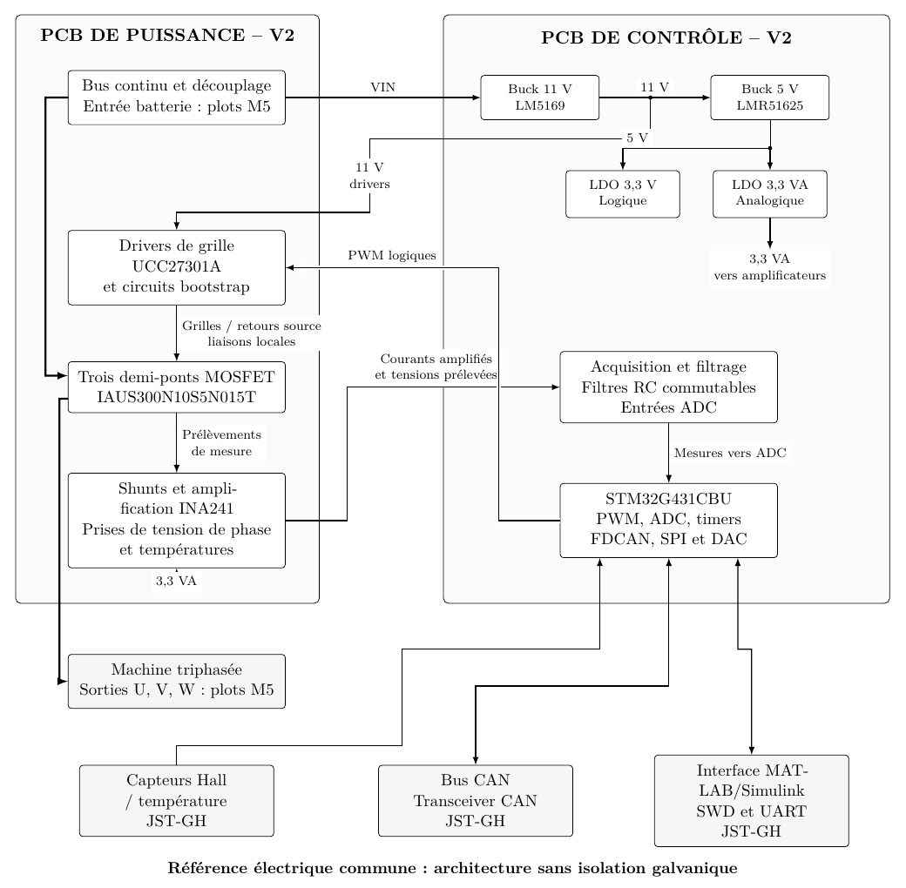
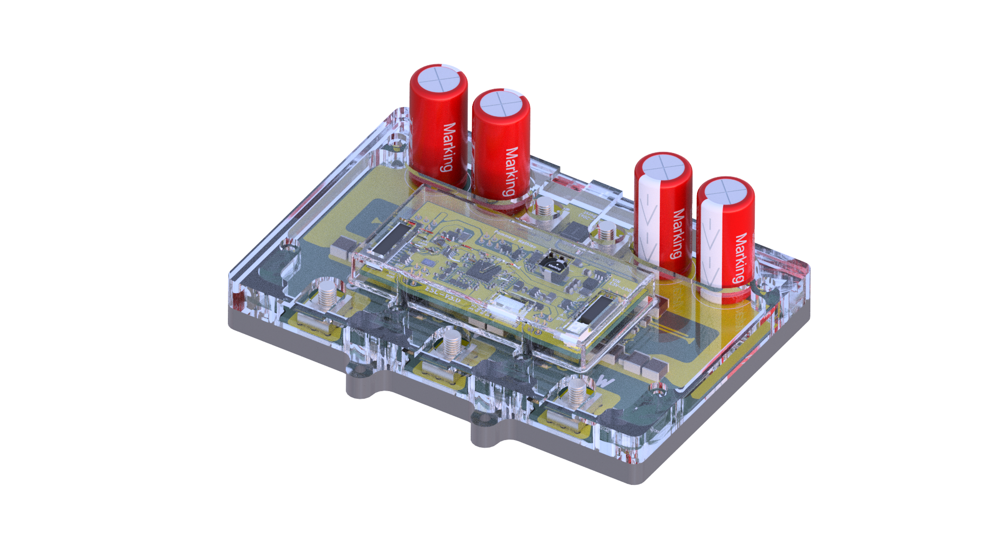
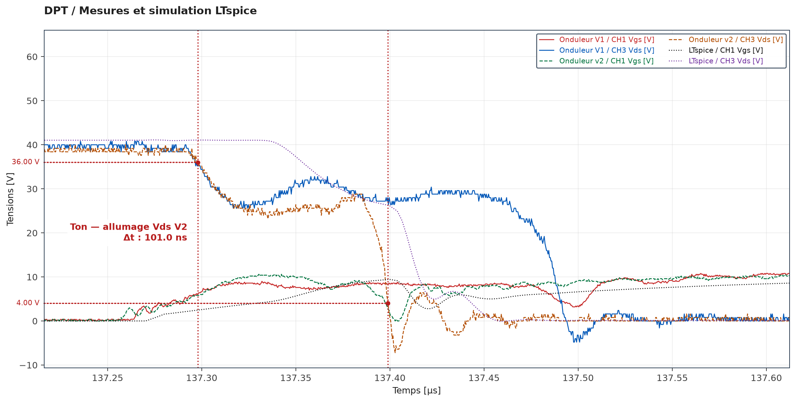
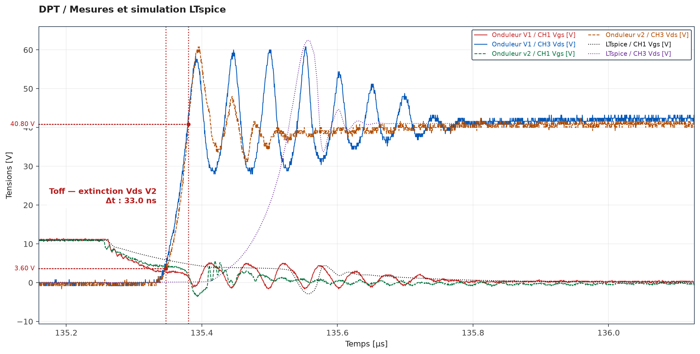

# NICE ESC

**Onduleur triphasé à deux cartes, conçu pour explorer la commande de moteurs BLDC/PMSM et la conversion d'énergie bidirectionnelle.**

Ce dépôt présente la partie **hardware V2** : conception électronique sous KiCad, intégration mécanique, modèles 3D et caractérisation des commutations par essai à double impulsion (*Double Pulse Test*, DPT).

## Architecture électronique

L'électronique est répartie entre deux PCB partageant une référence électrique commune, sans isolation galvanique :

- **Carte de puissance** : bus continu, condensateurs de découplage, trois demi-ponts MOSFET, drivers de grille et mesure des courants par shunts.
- **Carte de contrôle** : microcontrôleur STM32G4, alimentations auxiliaires, acquisition analogique, filtrage et interfaces de communication.

Les drivers et les amplificateurs de courant sont placés sur la carte de puissance, au plus près des MOSFET et des shunts. Les connexions entre cartes transportent les PWM logiques et les mesures déjà amplifiées : les boucles de commande de grille restent courtes et les faibles tensions des shunts sont traitées localement.

## Rendu de l'ensemble

La carte de contrôle se superpose à la carte de puissance. Les raccordements batterie et moteur utilisent des plots M5 ; les interfaces de signaux utilisent des connecteurs JST-GH. Les modèles STEP des cartes et du boîtier sont inclus dans le dépôt.

## Possibilités du hardware

| Fonction | Mise en œuvre |
|---|---|
| Commande triphasée | Trois demi-ponts, avec deux MOSFET IAUS300N10S5N015T en parallèle par interrupteur, soit 12 MOSFET au total |
| Commande de grille | Drivers UCC27301A avec circuits bootstrap et alimentation d'environ 11 V |
| Calcul et PWM | STM32G431CBU, PWM complémentaires et acquisition ADC pour le développement de commandes moteur |
| Mesure de courant | Shunts et amplificateurs INA241 sur la carte de puissance |
| Acquisition | Mesures de courant, tensions de phase et températures ; filtres RC commutables sur la carte de contrôle |
| Retour de position | Entrées pour capteurs Hall du moteur |
| Communication et mise au point | Interface CAN, UART et accès SWD |
| Alimentations auxiliaires | Conversion du bus vers 11 V puis 5 V, avec rails 3,3 V logique et analogique |

Cette base matérielle permet de développer des commandes six-pas ou FOC, d'exploiter les capteurs Hall et d'étudier le fonctionnement moteur ou le redressement actif, selon le firmware utilisé. Le présent dépôt est consacré à l'électronique et à ses essais.

Le dimensionnement vise notamment un bus de **15 à 48 V**, un courant de phase de **200 A crête** et une fréquence de découpage de **5 à 40 kHz**. Ce sont des objectifs de conception : les résultats de commutation présentés ci-dessous ont été obtenus à environ **40 V / 200 A** et ne constituent pas une qualification à 200 A continus.

## Assemblage en animation

## Caractérisation par Double Pulse Test

Le DPT permet d'observer la commutation d'un demi-pont sous charge inductive. La première impulsion établit le courant dans une bobine à air ; sa fin permet d'étudier l'extinction des MOSFET. Après une courte phase de roue libre, la seconde impulsion permet d'observer leur réallumage sous courant.

| Paramètre de l'essai | Condition |
|---|---|
| Tension du bus continu | Environ 40 V |
| Courant au premier blocage | Environ 200 A dans l'inductance |
| Charge | Bobine à air d'environ 8 µH |
| Commande de grille | Environ 11 V |
| Grandeurs observées | Tension grille-source VGS, tension drain-source VDS, courant de l'inductance et tension de bus |

### Allumage

Sur la V2, la descente de VDS entre les seuils indiqués de 36 V et 4 V dure environ **101 ns**. Les courbes comparent la V2 à une première itération de référence et à une simulation LTspice.

### Extinction

Le front montant de VDS, entre les seuils indiqués de 3,6 V et 40,8 V, dure environ **33 ns** sur la V2. Les oscillations après extinction s'amortissent plus rapidement que sur la première itération dans cette acquisition. Ces valeurs caractérisent les fronts de tension mesurés ; elles ne représentent pas les délais complets de commande des MOSFET.

Le courant acquis est celui de l'inductance, et non directement le courant drain pendant les transitions. Ces acquisitions servent donc à examiner les fronts, les surtensions et les oscillations de grille, sans en déduire une mesure précise des énergies de commutation Eon/Eoff.

Les [acquisitions et le script de visualisation](DOC_AND_SIMULATION/DPT_200A/) ainsi que le [circuit LTspice](DOC_AND_SIMULATION/LTSPICE_SIMULATION_DPT/) sont disponibles. Le modèle LTspice fourni utilise notamment un bus de 40,2 V, une inductance de 10 µH avec 0,15 Ω de résistance série, une première impulsion de 93 µs et des durées de roue libre et de seconde impulsion de 2 µs.

## Explorer les fichiers

| Dossier | Contenu |
|---|---|
| [Carte de contrôle V2](HARDWARE/V2/CONTROL_BOARD_V2/) | Projet KiCad, schémas, PCB, bibliothèques locales et modèles 3D |
| [Carte de puissance V2](HARDWARE/V2/POWER_BOARD_V2/) | Projet KiCad, schémas, PCB, bibliothèques locales et modèles 3D |
| [Assemblages STEP](HARDWARE/V2/3D/) | Modèles 3D des cartes |
| [Boîtier](HARDWARE/INVERTER_CASE_3D/) | Modèles STEP des parties supérieure et inférieure |
| [Documentation et essais](DOC_AND_SIMULATION/) | Simulation DPT, acquisitions et médias du projet |

Pour ouvrir les cartes, utiliser **KiCad 10** et charger le fichier `.kicad_pro` du projet souhaité. Les bibliothèques suffixées `_local` et les modèles 3D sont inclus ; leurs chemins utilisent `${KIPRJMOD}` pour rester relatifs au dossier du projet.
